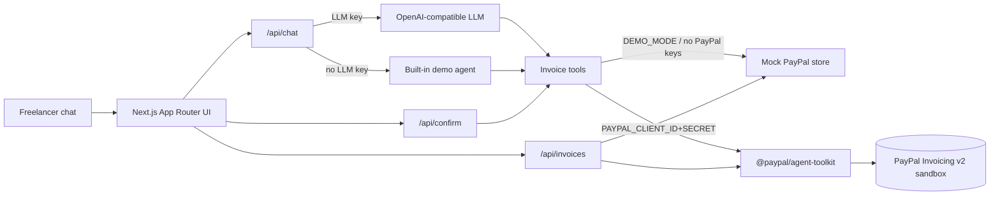

# PayPal Invoice Copilot

> Chat-based AI agent that creates, sends, reminds, cancels, and tracks **PayPal invoices** for freelancers and small businesses.

Built for the [PayPal AI Hackathon](https://paypalaihackathon.devpost.com/) (deadline **Nov 12, 2026 12:00pm PST** / **03:00 Nov 13 VN**).

   

---

## Problem

Freelancers lose hours every week bouncing between chat notes, spreadsheets, and the PayPal invoice UI. Turning “bill Acme $500 for the logo, due in two weeks, chase them if they ghost” into an actual PayPal invoice is tedious — and easy to forget.

## Solution

**Invoice Copilot** is an agentic commerce assistant. You type natural language; the agent:

1. Drafts a PayPal invoice (sandbox or live)
2. Asks for **human confirmation** before send / remind / cancel
3. Tracks status on a live invoice desk
4. Generates payment QR / links
5. Summarizes who owes what

Targets: **Grand Prize**, **Best Use of PayPal + AI**, **Best Use of Agentic Commerce**.

## Features

- Natural-language invoice creation (`Invoice Acme Corp $500 for logo design, due in 14 days`)
- PayPal **Agent Toolkit** invoicing tools (`create`, `list`, `get`, `send`, `remind`, `cancel`, `QR`, …)
- Human-in-the-loop confirmation cards for destructive actions
- Invoice desk dashboard (unpaid / collected / drafts)
- **Demo mode** that works with **zero credentials** (built-in demo agent + mock PayPal store)
- OpenAI-compatible LLM config (Groq / OpenRouter / Gemini / OpenAI)
- Deployable to Vercel or Render

## Architecture



## PayPal APIs & AI tools used

| Layer | What |
| --- | --- |
| `@paypal/agent-toolkit` (AI SDK adapter) | `create_invoice`, `list_invoices`, `get_invoice`, `send_invoice`, `send_invoice_reminder`, `cancel_sent_invoice`, `generate_invoice_qr_code`, … |
| PayPal REST | Invoicing v2 under the toolkit (sandbox by default) |
| Vercel AI SDK (`ai`) | Tool-calling agent with `generateText` / `streamText` |
| Built-in demo agent | Deterministic NLU when `LLM_API_KEY` is missing — judges can still run end-to-end |

## Quick start (demo — no keys)

```bash
git clone https://github.com/nnquangit/paypal-invoice-copilot.git
cd paypal-invoice-copilot
npm install
npm run dev
```

Open [http://localhost:3000](http://localhost:3000). Click a suggestion chip or type:

> Invoice Acme Corp $500 for logo design, due in 14 days, remind them in 3 days if unpaid

Confirm the send card. Watch the invoice desk update.

```bash
npm test    # mock PayPal + demo agent tests
npm run build
```

> **Note:** `npm run build` / `dev` / `start` auto-fall back to `@next/swc-wasm-nodejs` if the native SWC binary cannot load (some sandboxed Linux hosts). On Vercel / normal laptops native SWC is used.


## Live PayPal sandbox + LLM

1. Copy env file:
   ```bash
   cp .env.example .env.local
   ```
2. Fill credentials (exact list below).
3. Restart `npm run dev`.

### Credentials checklist

| Env var | Required for | Where to get it |
| --- | --- | --- |
| `PAYPAL_CLIENT_ID` | Live PayPal calls | [PayPal Developer Dashboard → Apps & Credentials → Sandbox](https://developer.paypal.com/dashboard/applications/sandbox) → create/open an app → **Client ID** |
| `PAYPAL_CLIENT_SECRET` | Live PayPal calls | Same page → **Secret** (Show) |
| `PAYPAL_ENVIRONMENT` | Live PayPal calls | Set to `sandbox` for the hackathon |
| `LLM_API_KEY` | Live LLM agent | Free options: [Groq console keys](https://console.groq.com/keys) (`gsk_…`), [OpenRouter keys](https://openrouter.ai/keys), or [Google AI Studio](https://aistudio.google.com/apikey) |
| `LLM_BASE_URL` | Live LLM agent | Groq: `https://api.groq.com/openai/v1` · OpenRouter: `https://openrouter.ai/api/v1` · Gemini: `https://generativelanguage.googleapis.com/v1beta/openai/` |
| `LLM_MODEL` | Live LLM agent | e.g. `llama-3.3-70b-versatile` (Groq) |

Without those keys the app stays in polished **demo mode**.

## Deploy

- **Vercel:** import the repo, set the env vars above, deploy (`vercel.json` included).
- **Render:** use `render.yaml` (free web service) and paste the same secrets in the dashboard.

## Project structure

```
src/
  app/                 # App Router pages + API routes
  components/          # Chat, confirm cards, invoice desk
  lib/                 # config, mock store, PayPal tools, demo agent, LLM
docs/
  DEMO_SCRIPT.md       # <3 min video script
  SUBMISSION.md        # Devpost submission text
tests/                 # Vitest (mock PayPal)
```

## License

MIT © Quang Ngo
