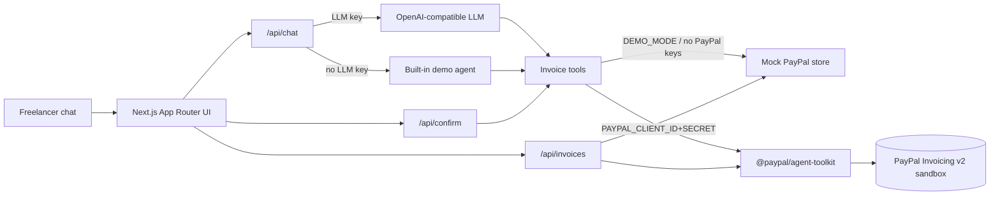

# PayPal Invoice Copilot

> Chat-based AI agent that creates, sends, reminds, cancels, and tracks **PayPal invoices** for freelancers and small businesses.

Built for the [PayPal AI Hackathon](https://paypalaihackathon.devpost.com/) (deadline **Nov 12, 2026 12:00pm PST** / **03:00 Nov 13 VN**).

   

---

## Problem

Freelancers lose hours every week bouncing between chat notes, spreadsheets, and the PayPal invoice UI. Turning “bill Acme $500 for the logo, due in two weeks, chase them if they ghost” into an actual PayPal invoice is tedious — and easy to forget.

## Solution

**Invoice Copilot** is an agentic commerce assistant. You type natural language; the agent:

1. Drafts an invoice on **PayPal sandbox** (or on a local mock desk when no PayPal keys are set; every result says which)
2. Asks for **human confirmation** before send / remind / cancel; only the UI's Confirm button executes them, not the model
3. Tracks status on an invoice desk
4. Shows the PayPal payment link when PayPal returns one, plus a clearly labelled **placeholder** QR image (not scannable)
5. Summarizes who owes what

Targets: **Grand Prize**, **Best Use of PayPal + AI**, **Best Use of Agentic Commerce**.

## Features

- Natural-language invoice creation (`Invoice Acme Corp $500 for logo design, due in 14 days`)
- PayPal **Agent Toolkit** invoicing tools on **sandbox only** (`create`, `list`, `get`, `send`, `remind`, `cancel`)
- Human-in-the-loop confirmation cards: server-side pending actions bound to your browser session, executed at most once
- Invoice desk dashboard (unpaid / collected / drafts) with its source shown (PayPal sandbox vs local mock)
- **Demo mode** that works with **zero credentials** (built-in demo agent + local mock store; no PayPal call, no email)
- OpenAI-compatible LLM config (Groq / OpenRouter / Gemini / OpenAI)
- Hosted demo on Vercel or Render (zero-key demo only; live credentials are local-only)

## Architecture



## PayPal APIs & AI tools used

| Layer | What |
| --- | --- |
| `@paypal/agent-toolkit` (AI SDK adapter) | `create_invoice`, `list_invoices`, `get_invoice`, `send_invoice`, `send_invoice_reminder`, `cancel_sent_invoice`, `generate_invoice_number` (probe) |
| PayPal REST | Invoicing v2 under the toolkit, **sandbox only** (`sandbox: true` is hard-coded) |
| Vercel AI SDK (`ai`) | Tool-calling agent with `generateText` (the model can only *propose* send / remind / cancel) |
| Built-in demo agent | Deterministic NLU when `LLM_API_KEY` is missing — judges can still run end-to-end |

## Quick start (demo — no keys)

```bash
git clone https://github.com/nnquangit/paypal-invoice-copilot.git
cd paypal-invoice-copilot
npm ci
npm run dev
```

Open [http://localhost:3000](http://localhost:3000). Click a suggestion chip or type:

> Invoice Acme Corp $500 for logo design, due in 14 days, remind them in 3 days if unpaid

Confirm the send card. Watch the invoice desk update. In demo mode everything is a **local mock**: no PayPal call is made and no email is sent.

```bash
npm test    # offline: mock store, demo agent, HITL/ownership, XSS, env guards, stubbed PayPal + fake LLM
npm run build
```

> **Note:** `npm run build` / `dev` / `start` auto-fall back to `@next/swc-wasm-nodejs` if the native SWC binary cannot load (some sandboxed Linux hosts). On Vercel / normal laptops native SWC is used.


## Live PayPal sandbox + LLM

1. Copy env file:
   ```bash
   cp .env.example .env.local
   ```
2. Fill credentials (exact list below).
3. Restart with `npm run dev` (or `npm run build && npm start`) and open `http://localhost:3000` on the same machine. Both go through `scripts/serve.sh`, which binds **127.0.0.1**. The server ignores credentials when it was not launched that way (for example plain `next start`, or a public bind).

### Credentials checklist

| Env var | Required for | Where to get it |
| --- | --- | --- |
| `PAYPAL_CLIENT_ID` | Live PayPal calls | [PayPal Developer Dashboard → Apps & Credentials → Sandbox](https://developer.paypal.com/dashboard/applications/sandbox) → create/open an app → **Client ID** |
| `PAYPAL_CLIENT_SECRET` | Live PayPal calls | Same page → **Secret** (Show) |
| `PAYPAL_ENVIRONMENT` | Live PayPal calls | `sandbox` (or empty). Any other value (`live`, `production`, …) disables PayPal: this build is sandbox-only |
| `LLM_API_KEY` | Live LLM agent | Free options: [Groq console keys](https://console.groq.com/keys) (`gsk_…`), [OpenRouter keys](https://openrouter.ai/keys), or [Google AI Studio](https://aistudio.google.com/apikey) |
| `LLM_BASE_URL` | Live LLM agent | Groq: `https://api.groq.com/openai/v1` · OpenRouter: `https://openrouter.ai/api/v1` · Gemini: `https://generativelanguage.googleapis.com/v1beta/openai/` |
| `LLM_MODEL` | Live LLM agent | Default `openai/gpt-oss-20b` (Groq, tool-calling) |

Without those keys the app stays in polished **demo mode**.

## Security & limits

- **No user authentication.** Live credentials are honoured only on a server bound to **127.0.0.1**. `npm run dev` / `npm start` bind it through `scripts/serve.sh`, which sets `IC_BIND_HOST`, and the server checks that value. As defence in depth, the API also refuses non-loopback `Host` / `X-Forwarded-For` (`403 live_mode_local_only`); those headers alone are spoofable. POSTs must be same-origin JSON.
- **Human in the loop:** the model has no confirm or execute tool. `POST /api/confirm` is the only path, and it requires the `ic_sid` HttpOnly session cookie of the browser that got the proposal. Within one server process, each action is sent to PayPal **at most once**. Only a failure *before* dispatch (PayPal unavailable) can be confirmed again. If a dispatched call fails ambiguously (network error, 5xx), the action becomes `outcome_unknown` and is never retried: check the invoice in the PayPal sandbox dashboard before proposing again. Across restarts, or if you re-propose, there is no exactly-once guarantee.
- **Honest provenance:** results and desk rows say `paypal-sandbox` or `local-mock`. A PayPal error is shown as an error, never replaced by a fake local success.
- **Single process, in memory:** invoices and pending actions are lost on restart and not shared across instances. That is why credentials are ignored on hosted platforms (`VERCEL` / `RENDER` env).
- **QR** is a labelled placeholder image. PayPal's QR API is not called.
- Details and the remaining gaps: [docs/security.html](docs/security.html).

## Deploy

Hosted deploys run the **zero-key demo only**. The app ignores PayPal and LLM credentials when it detects Vercel or Render.

- **Vercel:** import the repo and deploy (`vercel.json` included). Do not add credentials; they are ignored.
- **Render:** use `render.yaml` (one free instance, `PUBLIC_DEMO=true` + `DEMO_MODE=true`). `PUBLIC_DEMO=true` is the only way to make `npm start` bind `0.0.0.0`, and `serve.sh` refuses to start that way unless `DEMO_MODE=true`.

## Project structure

```
src/
  app/                 # App Router pages + API routes
  components/          # Chat, confirm cards, invoice desk
  lib/                 # config, mock store, PayPal tools, demo agent, LLM
docs/
  index.html           # Reader docs: Overview, Setup, How it works, Security, API, Demo script
  workmap.html         # Work map (generated by scripts/workmap.py)
  SUBMISSION.md        # Devpost submission text
  media/               # Demo + explainer videos, captions, thumbnail, gallery screenshots
video/                 # Remotion explainer (not part of Next build)
tests/                 # Vitest, fully offline (mock store, security, stubbed PayPal toolkit, fake LLM)
```

## License

MIT © Quang Ngo

## Docs & media

- Reader docs (static HTML; open `docs/index.html` directly or serve `docs/`): [Overview](docs/index.html) · [Setup](docs/setup.html) · [How it works](docs/how-it-works.html) · [Security & known gaps](docs/security.html) · [API](docs/api.html) · [Demo script](docs/demo.html)
- Videos: [`docs/media/devpost-demo.mp4`](docs/media/devpost-demo.mp4) (Devpost demo, captions in `devpost-demo.srt`) and [`docs/media/invoice-copilot-explainer.mp4`](docs/media/invoice-copilot-explainer.mp4) (Remotion source in [`video/`](video/))
- Devpost gallery images: [`docs/media/gallery/`](docs/media/gallery/)

Default Groq model: `openai/gpt-oss-20b` (tool-calling). Enable **Invoicing** on your PayPal sandbox REST app (Developer Dashboard → Features) for live PayPal invoice IDs — OAuth alone is not enough.

<!-- workmap:readme -->
## Work map

Progress is on the [work map](docs/workmap.html): Epics → Features → Tasks → Subtasks with status and owner on every node, kept by the agents with `python3 scripts/workmap.py`. The page opens from a file or any static server; the source of truth is `docs/shared/workmap.md`.
<!-- /workmap:readme -->
